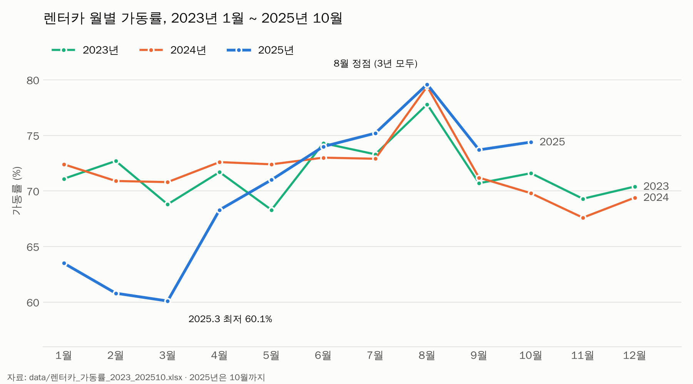

# 렌터카 연도별 가동률 분석 보고서 (2023년 1월 ~ 2025년 10월)

- **데이터:** `data/렌터카_가동률_2023_202510.xlsx` (월별 등록대수, 승용·승합 대여시간, 총 대여시간, 가동률)
- **작성:** Claude Code (AI 분석), 2026-11-10
- **비교 기준:** 2025년은 10월까지만 있어서, 연도 비교는 **1~10월끼리** 했습니다.

> ⚠️ 파일에 출처, 지역, 대여시간 단위, 가동률 계산식이 적혀 있지 않습니다. 원인은 데이터만으로 알 수 없어서 **해석은 가설**로 적었습니다.

## 핵심 요약

1. **2025년 1~10월 평균 가동률은 70.1%로 세 해 중 가장 낮습니다.** 2023년은 72.0%, 2024년은 72.5%였습니다.
2. **원인은 상반기 초반입니다.** 2025년 1~3월 평균은 61.5%로 2024년(71.4%)보다 9.9%p 낮고, 총 대여시간도 14.4% 줄었습니다.
3. **6월부터는 반대로 세 해 중 가장 높습니다.** 2025년 6~10월 평균은 75.4%(2024년 73.3%)이고, 총 대여시간은 6.8% 늘었습니다.
4. **세 해 모두 8월이 정점입니다** (77.8% → 79.4% → 79.6%). 여름 성수기 패턴이 매년 반복됩니다.
5. 1~10월 총 대여시간은 2025년이 2024년보다 1.5% 적어, 연간으로 보면 큰 차이는 아닙니다.

## 1. 연도별 비교 (1~10월)

| 연도 | 평균 가동률 | 총 대여시간 | 평균 등록대수 | 승합차 비중 | 최고 달 | 최저 달 |
|---|---|---|---|---|---|---|
| 2023 | 72.0% | 1,241,811 | 23,521 | 6.1% | 8월 77.8% | 5월 68.3% |
| 2024 | 72.5% | 1,284,726 | 23,774 | 6.3% | 8월 79.4% | 10월 69.8% |
| 2025 | **70.1%** | 1,266,081 | 23,654 | 6.1% | 8월 79.6% | **3월 60.1%** |

참고로 1~12월 전체 평균은 2023년 71.7%, 2024년 71.9%입니다.

## 2. 시기별 비교

| 시기 | 2023 | 2024 | 2025 | 2025 vs 2024 가동률 | 2025 vs 2024 대여시간 |
|---|---|---|---|---|---|
| 1~3월 | 70.9% | 71.4% | 61.5% | **-9.9%p** | **-14.4%** |
| 4~5월 | 70.0% | 72.5% | 69.7% | -2.8%p | -3.4% |
| 6~10월 | 73.5% | 73.3% | 75.4% | **+2.1%p** | **+6.8%** |

## 3. 2025년 월별 변화 (전년 같은 달 대비)

| 월 | 2024 | 2025 | 차이 |
|---|---|---|---|
| 1월 | 72.4% | 63.5% | -8.9%p |
| 2월 | 70.9% | 60.8% | -10.1%p |
| 3월 | 70.8% | 60.1% | -10.7%p |
| 4월 | 72.6% | 68.3% | -4.3%p |
| 5월 | 72.4% | 71.0% | -1.4%p |
| 6월 | 73.0% | 74.0% | +1.0%p |
| 7월 | 72.9% | 75.2% | +2.3%p |
| 8월 | 79.4% | 79.6% | +0.2%p |
| 9월 | 71.2% | 73.7% | +2.5%p |
| 10월 | 69.8% | 74.4% | +4.6%p |

2025년은 1~3월에 크게 낮았다가 4월부터 차이가 줄고, 6월부터 전년을 넘었습니다.

## 4. 해석 (가설, 확인 필요)

- **2025년 초 수요 감소:** 등록대수는 1~3월에 약 23,700~24,200대로 예년과 비슷한데 대여시간이 줄었습니다. 차가 남은 것이 아니라 **빌리는 사람이 줄어서** 가동률이 떨어진 것으로 보입니다. 관광객 수 같은 외부 자료와 함께 확인해야 원인을 말할 수 있습니다.
- **하반기 회복:** 대여시간이 늘면서 가동률도 올랐습니다. 다만 10월은 아래 데이터 문제 때문에 따로 봐야 합니다.
- **승합차 비중은 6% 안팎으로 일정합니다.** 차종 구성이 바뀌어서 생긴 변화는 아닙니다.

## 5. 데이터 확인이 필요한 부분

| 항목 | 내용 | 영향 |
|---|---|---|
| 2025년 10월 등록대수 | 19,571대로 9월(24,304대)보다 약 4,700대 줄었는데 대여시간은 늘었음 | 입력 오류나 집계 기준 변경 가능성. 10월 가동률(74.4%) 해석에 주의 |
| 합계 불일치 | 승용+승합 ≠ 총 대여시간: 2024년 9월 60 차이, 2023년 10월 1 차이 | 결론에는 영향 작음 |
| 단위·정의 | 대여시간 단위, 가동률 계산식, 지역·출처 미기재 | 가동률을 등록대수와 대여시간으로 다시 계산해 검증할 수 없음 |

## 다음에 해 볼 것

- [ ] 데이터 출처와 단위, 가동률 계산식 확인
- [ ] 2025년 10월 등록대수 원자료 확인
- [ ] 같은 기간 관광객 수 데이터와 비교해 2025년 초 하락 원인 확인
- [ ] 2025년 11~12월 데이터가 나오면 연간 비교 업데이트
