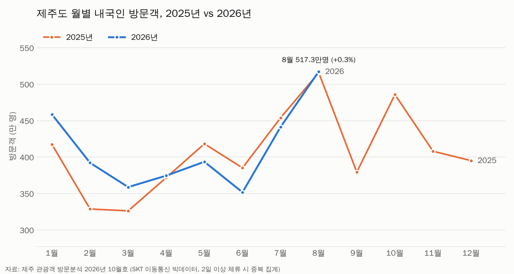
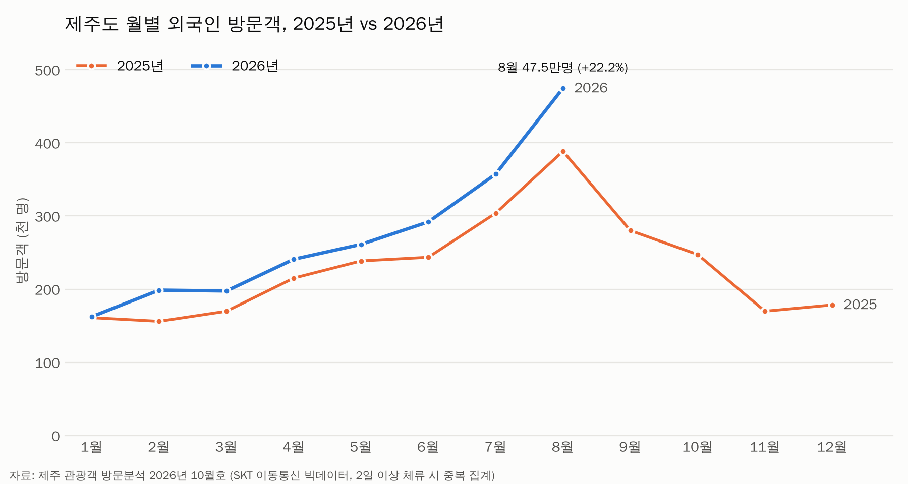
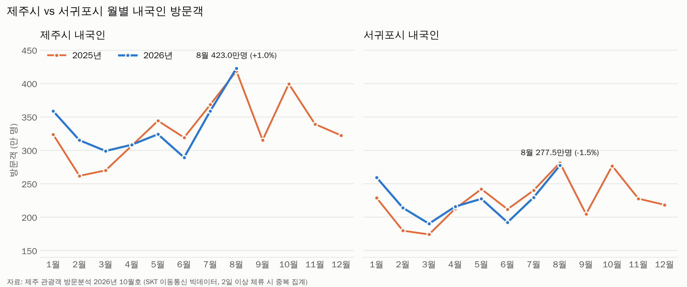

# 제주 관광객 방문분석 요약 보고서 (2026년 8월 기준)

- **원자료:** `data/제주_관광객_방문분석_2026년10월호.pdf` (제주특별자치도 관광실태 빅데이터 분석 보고서 2026년 10월호, 분석 연월 2026년 8월)
- **정리한 데이터:** `data/제주_월별방문객_2025_202608_정제.csv` (PDF 표의 숫자를 옮겨 적은 파일)
- **작성:** Claude Code (AI 정리), 2026-11-10

> ⚠️ **수치를 읽을 때 주의하세요.** 이 수치는 SKT 이동통신 데이터 기반입니다. 2일 이상 머문 관광객은 하루마다 1명씩 **중복 집계**되므로 실제 입도객보다 값이 큽니다(예: 3일 체류 → 3명). 따라서 절대 숫자보다 **전년 대비 증감**에 주목해야 합니다. 제주시와 서귀포시를 둘 다 방문한 사람은 양쪽에 모두 잡히므로 두 시를 더하면 도 전체보다 많습니다.

## 8월 핵심 요약

| 구분 | 2025년 8월 | 2026년 8월 | 증감 | 증감률 |
|---|---|---|---|---|
| 제주도 내국인 | 5,158,518 | 5,173,454 | +14,936 | **+0.3%** |
| 제주도 외국인 | 388,520 | 474,771 | +86,251 | **+22.2%** |
| 제주시 내국인 | 4,187,797 | 4,229,669 | +41,872 | **+1.0%** |
| 서귀포시 내국인 | 2,815,742 | 2,774,882 | -40,860 | **-1.5%** |

1. **내국인은 제자리걸음(+0.3%)입니다.** 8월은 1년 중 방문객이 가장 많은 달이지만 전년과 거의 같았습니다.
2. **외국인은 크게 늘었습니다(+22.2%).** 2026년 들어 8개월 연속 전년보다 많고, 8월 증가 폭이 가장 큽니다.
3. **중국인이 외국인 증가를 이끌었습니다.** 중국 341,509명(+27.6%)으로 외국인의 71.9%를 차지합니다. 일본(+2.3%)은 거의 그대로이고, 대만(+18.7%)도 늘었습니다.
4. **내국인은 제주시가 늘고(+1.0%) 서귀포시가 줄었습니다(-1.5%).** 서귀포시는 6월부터 3달 연속 감소입니다.
5. **연령별로는 60대(+6.5%)와 70대(+9.6%)가 늘고 20대(-4.9%)와 30대(-2.7%)가 줄었습니다.**

## 1. 제주도 월별 내국인 방문객 추이

| 월 | 1월 | 2월 | 3월 | 4월 | 5월 | 6월 | 7월 | 8월 |
|---|---|---|---|---|---|---|---|---|
| 2025년 | 4,174,116 | 3,287,811 | 3,262,373 | 3,718,991 | 4,182,534 | 3,851,906 | 4,539,604 | 5,158,518 |
| 2026년 | 4,585,273 | 3,921,381 | 3,588,326 | 3,745,554 | 3,936,041 | 3,517,034 | 4,413,402 | 5,173,454 |
| 증감률 | +9.9% | +19.3% | +10.0% | +0.7% | -5.9% | -8.7% | -2.8% | +0.3% |

- **1~8월 누적:** 3,288만 명, 전년 대비 **+2.2%**
- **1~3월은 +12.8%로 크게 늘었고, 4~7월은 -4.2%로 줄었습니다.**
- 1~3월 증가는 **2025년 초가 유난히 낮았던 기저효과**일 가능성이 큽니다. 같은 저장소의 렌터카 분석(`2026-11-10_렌터카_가동률_분석보고서.md`)에서도 2025년 1~3월 가동률이 전년보다 약 10%p 낮았습니다.

## 2. 제주도 월별 외국인 방문객 추이

| 월 | 1월 | 2월 | 3월 | 4월 | 5월 | 6월 | 7월 | 8월 |
|---|---|---|---|---|---|---|---|---|
| 2025년 | 161,023 | 156,022 | 169,800 | 215,103 | 238,595 | 243,601 | 303,903 | 388,520 |
| 2026년 | 162,302 | 198,638 | 197,484 | 240,874 | 261,237 | 291,927 | 357,309 | 474,771 |
| 증감률 | +0.8% | +27.3% | +16.3% | +12.0% | +9.5% | +19.8% | +17.6% | +22.2% |

- **1~8월 누적:** 218만 명, 전년 대비 **+16.4%**
- 8월 국적 순위: 1위 중국 341,509명(71.9%), 2위 일본 41,173명(8.7%), 3위 대만 29,321명(6.2%), 4위 홍콩, 5위 마카오
- 원자료는 외국인이 휴대폰 사용량이 적어 **내국인보다 추정 오차가 크다**고 밝히고 있습니다.

## 3. 제주시 vs 서귀포시 내국인 방문객

| 월 | 1월 | 2월 | 3월 | 4월 | 5월 | 6월 | 7월 | 8월 | 1~8월 누적 |
|---|---|---|---|---|---|---|---|---|---|
| 제주시 증감률 | +10.8% | +20.4% | +10.7% | +0.5% | -5.9% | -9.3% | -2.6% | **+1.0%** | +2.4% |
| 서귀포시 증감률 | +13.3% | +19.0% | +9.2% | +1.5% | -6.0% | -9.3% | -4.4% | **-1.5%** | +2.0% |

- 두 시는 비슷하게 움직였지만 **7~8월에 서귀포시가 더 약했습니다.** 8월에는 제주시만 늘었습니다.
- 8월 내국인 방문이 많은 행정동은 용담2동(1,945,413명, +31.1%), 애월읍(-1.4%), 안덕면(+2.6%) 순입니다. 서귀포시의 대정읍(-18.8%)과 예래동(-5.9%)이 줄었습니다.

## 4. 시사점 (해석, 확인 필요)

- **내국인 회복이 약합니다.** 연초 증가는 기저효과 영향이 크고, 성수기인 5~7월에는 오히려 줄었습니다. 8월(+0.3%)도 제자리입니다.
- **외국인, 특히 중국인 의존도가 커지고 있습니다.** 외국인의 72%가 중국인이라 한 국가의 정책이나 항공편 변화에 크게 흔들릴 수 있습니다.
- **서귀포시의 여름 감소는 따로 살펴볼 필요가 있습니다.** 행정동별 자료(원자료 3장)로 어느 지역이 줄었는지 확인해 볼 수 있습니다.
- **20~30대가 줄고 60~70대가 늘었습니다.** 젊은 층을 겨냥한 상품과 고령층 편의시설을 함께 고민할 필요가 있습니다.

## 원자료에는 있지만 이 요약에 넣지 않은 것

- 성·연령대별 상세 표 (원자료 6~7쪽)
- 출발 지역별(시도·시군) 방문객 (8~9쪽)
- 행정동·블록 단위 상위 15위와 연령층별 분석 (10~11쪽, 4장, 5장)
- 제주시·서귀포시 외국인 방문객 (22~25쪽, 34~37쪽)
